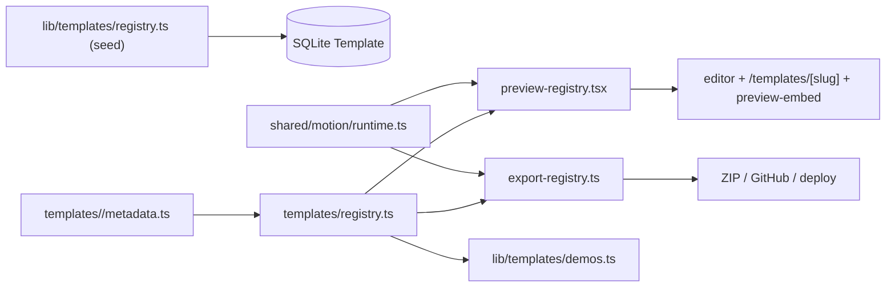

# Building Templates

This guide explains how the template system works and how to add a new bespoke
design in about five minutes. A "template" is one **complete, finished website
design** (ForgeTech, Techvantage, CraftedSpaces). Users pick one design; the AI
fills its locked content slots. They never assemble a site from loose sections.

- [Concepts](#concepts)
- [Directory structure](#directory-structure)
- [How a template renders](#how-a-template-renders)
- [The motion system](#the-motion-system)
- [Add a template in 5 minutes](#add-a-template-in-5-minutes)
- [Boilerplate](#boilerplate)
- [Registering + publishing](#registering--publishing)
- [Validation & testing](#validation--testing)
- [Troubleshooting](#troubleshooting)

---

## Concepts

Two kinds of design exist:

| Kind | `renderer` | Rendered by |
| --- | --- | --- |
| **Bespoke** | its own slug (`forgetech`, ...) | a dedicated React `site.tsx` + static `export.ts` |
| **Standard** | `standard-sections` | the generic section registry (`components/website-sections`) |

Every design has a **locked, ordered list of section slots** (`sections` in its
seed). The AI only writes the copy/images for those slots; it can never add,
remove, or reorder them. Locking is enforced in three places:

- generation — `conformToTemplate` (`lib/agents/template-fill.ts`)
- prompting — `templateSlots` (`lib/ai/prompt-builder.ts`)
- editor saves — `assertMatchesTemplate` (`lib/agents/editor.ts`)

Metadata (name, tagline, thumbnail, locked sections, `published`) lives in the
**database**, seeded from `lib/templates/registry.ts`. The running app always
reads templates from the DB via `lib/templates/store.ts`.

---

## Multi-page templates & the page catalog

A design can be **single-page** (just `home`) or **multi-page**. Multi-page
designs declare a `pages` list in their seed; each page has its own locked,
ordered slot list. Single-page designs keep declaring only `sections` (the home
page) and behave exactly as before — the change is fully backward compatible.

The allowed page types come from a fixed **page catalog**
(`lib/blueprint/page-catalog.ts`):

```text
home (ALWAYS included), about, services, pricing, contact, faq, blog, portfolio
```

**The AI decides which pages to generate.** A template declares every page it
*supports*; at generation time the heavy model picks which of the *optional*
pages fit the business (home is always emitted). The choice is enforced
deterministically in `conformToTemplate` (`lib/agents/template-fill.ts`): an
optional page is kept only if the model returned a page with that slug and the
template supports it, and each kept page is rebuilt to that page's locked slots.
The deterministic/mock path (`lib/ai/mock-blueprint.ts`) emits **all** of a
design's pages.

Storage: `Template.sections` is a JSON string that supports two shapes, parsed
by `lib/templates/pages.ts`:

```jsonc
// legacy single-page (still read):
["hero-...", "features-grid", ...]
// multi-page:
{ "pages": [ { "slug": "home", "title": "Home", "sections": [ ... ] }, ... ] }
```

A `SiteTemplate` exposes both `sections` (the home slots, for quotes/features and
single-page renderers) and `pages` (every page). Enforcement lives in the same
three places as single-page locking, extended per page:

- generation — `conformToTemplate` (page set + per-page slots)
- prompting — `buildHeavyPrompt` lists each page and its slots
- editor saves — `assertMatchesTemplate` validates each page's slot list

**Rendering a specific page.** `toSlots(blueprint, site, pageSlug)` reads the
requested page (default `home`). The bespoke React renderer (`site.tsx`) and its
static twin (`export.ts`) both accept a `pageSlug`, render that page, and link
between pages in their header/footer nav — `?page=<slug>` in the live preview,
and `/` + `/<slug>/` between the exported static files. The multi-page export
emits `index.html` for home and `<slug>/index.html` for the rest.

---

## Directory structure

Everything a bespoke design needs is co-located under `templates/<slug>/`:

```text
templates/
  contracts.ts            # shared types (TemplateModuleMeta, MotionProfile, ...)
  registry.ts             # central registry of bespoke modules (metadata)
  preview-registry.tsx    # renderer -> React preview  (client-safe)
  export-registry.ts      # renderer -> static HTML     (server-only)
  validate.ts             # `npm run templates:validate`
  shared/
    content.ts            # slot readers: toSlots / slotAt / text / list
    motion/
      profile.ts          # MotionProfile + defaults
      runtime.ts          # the ONE motion runtime + CSS (preview AND export)
      root.tsx            # <TemplateMotionRoot> client wrapper for previews
  <slug>/
    metadata.ts           # registers the module (motion, slots, demo, assets)
    site.tsx              # the React renderer (editor + live preview)
    export.ts             # the static-HTML twin (ZIP / GitHub / deploy)
    tokens.ts             # design tokens (colors, etc.)
    slots.ts              # slot index -> visual region (documentation + checks)
    assets.ts             # public-relative asset paths bundled into exports
    motion.ts             # the design's MotionProfile
    demo.ts               # sample blueprint for the public live demo
```

Static images live in `public/templates/<slug>/`. Library UI (gallery, preview
dialog, switch dialog) lives in `components/templates/` and is design-agnostic.

Metadata seeds still live in `lib/templates/registry.ts` because the Prisma seed
script consumes them directly; per-template `metadata.ts` re-registers rendering
concerns (motion, slots, demo, assets) beside the design.

---

## How a template renders



- **Preview** (`components/editor/site-preview.tsx`) calls `BespokePreview`,
  which wraps the design in `<TemplateMotionRoot>` and runs the motion runtime.
- **Export** (`lib/export/html-renderer.ts`) calls `renderBespokeSite`, which
  injects the same motion CSS + runtime via `withMotion`.
- **Assets** for the export bundle come from `bespokeAssetPaths` (the module's
  `assets.ts`) — no hardcoded lists.

There is exactly one dispatch per concern (preview / export / assets / demo), all
keyed off the `renderer`. Unknown renderers no longer silently fall back to the
generic section layout.

---

## The motion system

There is a **single motion runtime** (`templates/shared/motion/runtime.ts`) used
by BOTH the React preview and the exported static HTML, so they can never drift.

Most motion is **automatic** — you rarely add anything:

| Behavior | How | Markup needed |
| --- | --- | --- |
| Scroll reveal + stagger | headings/cards fade-up on enter, grid children stagger | none |
| FAQ open animation | native `<details>` panels animate open | none |
| Stat counters | short numeric values (`25+`, `98%`) count up in view | none |
| Hover + press feedback | gated to fine pointers; `:active` scale | none |
| Reduced motion | everything disabled, content stays visible | none |
| Parallax | gentle scroll parallax | add `data-parallax="0.1"` to an image inside an `overflow-hidden` box |

Opt out of reveal on any element or subtree with `data-motion-skip`.

Tokens (in the injected CSS): `--motion-fast: 140ms`, `--motion-base: 220ms`,
`--motion-reveal: 600ms`, `--motion-slow: 900ms`,
`--motion-ease: cubic-bezier(0.22, 1, 0.36, 1)`.

Per-design intensity comes from `templates/<slug>/motion.ts`:

```ts
import type { MotionProfile } from "@/templates/shared/motion/profile";

export const acmeMotion: MotionProfile = {
  intensity: "expressive", // "expressive" enables parallax + longer reveals
  parallax: true,
  staggerMs: 90,
};
```

Accessibility is built in: hover motion is gated behind
`@media (hover: hover) and (pointer: fine)`, and everything is disabled under
`@media (prefers-reduced-motion: reduce)` while keeping content fully visible.

---

## Add a template in 5 minutes

1. **Create the folder** `templates/<slug>/` and copy the [boilerplate](#boilerplate)
   files into it (`site.tsx`, `export.ts`, `tokens.ts`, `slots.ts`, `assets.ts`,
   `motion.ts`, `demo.ts`, `metadata.ts`).
2. **Add your assets** to `public/templates/<slug>/` and list them in `assets.ts`.
3. **Register the module** — add one line to `templates/registry.ts`:
   ```ts
   import { acmeMeta } from "./acme/metadata";
   export const TEMPLATE_MODULES = [forgetechMeta, techvantageMeta, craftedspacesMeta, acmeMeta];
   ```
4. **Register preview + export** — add your renderer to
   `templates/preview-registry.tsx` and `templates/export-registry.ts`
   (one entry each, keyed by renderer).
5. **Seed the metadata** — add a `TemplateSeed` to `lib/templates/registry.ts`
   (`ALL_SEEDS`) with the same `slug`, `renderer`, and locked `sections`. Add
   `<slug>` to `TEMPLATE_RENDERERS` in `lib/templates/types.ts`.
6. **Validate + seed + preview**:
   ```bash
   npm run templates:validate
   npm run db:seed
   npm run dev   # open /templates/<slug>
   ```
7. Set `published: true` in the seed once it looks right, then re-seed.

`npm run templates:validate` fails loudly if any of these steps is missing.

---

## Boilerplate

A complete minimal design. Replace `Acme` / `acme`, wire your slots, done.

`templates/acme/tokens.ts`
```ts
export const AC = {
  ink: "#101418",
  body: "#4b5563",
  surface: "#f6f7f9",
  accent: "#2563eb",
} as const;
```

`templates/acme/motion.ts`
```ts
import type { MotionProfile } from "@/templates/shared/motion/profile";

export const acmeMotion: MotionProfile = {
  intensity: "expressive",
  parallax: true,
  staggerMs: 90,
};
```

`templates/acme/slots.ts`
```ts
import type { TemplateSlotRegion } from "@/templates/contracts";

export const acmeSlots: TemplateSlotRegion[] = [
  { region: "hero", type: "hero", occurrence: 0 },
  { region: "services", type: "services", occurrence: 0 },
  { region: "cta", type: "cta", occurrence: 0 },
  { region: "footer", type: "footer", occurrence: 0 },
];
```

`templates/acme/assets.ts`
```ts
export const acmeAssets: string[] = ["templates/acme/hero.jpg"];
```

`templates/acme/demo.ts`
```ts
import type { WebsiteBlueprint } from "@/lib/blueprint/types";

const img = (url: string, altText: string) =>
  ({ provider: "placeholder", url, altText }) as const;

export function acmeDemoBlueprint(): WebsiteBlueprint {
  return {
    business: { name: "Acme", industry: "Services", description: "Demo." },
    design: { tone: "Modern", colorPalette: ["Blue"], typography: "Modern", visualStyle: "Modern" },
    seo: { title: "Acme | Services", description: "Acme demo site." },
    quoteSignals: [],
    pages: [
      {
        slug: "home",
        title: "Home",
        sections: [
          { id: "hero_1", type: "hero", variant: "hero-split-with-image",
            content: { headline: "Acme builds things", subheadline: "Demo copy.", ctaPrimary: "Get started" },
            selectedImage: img("/templates/acme/hero.jpg", "Acme hero") },
          { id: "svc_1", type: "services", variant: "services-cards",
            content: { heading: "What we do", itemTitles: ["A", "B", "C"], itemBodies: ["", "", ""] } },
          { id: "cta_1", type: "cta", variant: "cta-banner",
            content: { headline: "Ready?", subheadline: "Let's talk.", ctaPrimary: "Contact" } },
          { id: "foot_1", type: "footer", variant: "footer-simple",
            content: { businessName: "Acme", tagline: "Demo.", linkLabels: ["Home"] } },
        ],
      },
    ],
  };
}
```

`templates/acme/site.tsx`
```tsx
import type { AssembledSite, SiteContact, WebsiteBlueprint } from "@/lib/blueprint/types";
import { list, slotAt, text, toSlots } from "@/templates/shared/content";
import { AC } from "@/templates/acme/tokens";

export function AcmeSite({
  blueprint,
  site,
  contact,
}: {
  blueprint?: WebsiteBlueprint | null;
  site?: AssembledSite | null;
  contact?: SiteContact | null;
}) {
  const slots = toSlots(blueprint, site);
  const hero = slotAt(slots, "hero");
  const services = slotAt(slots, "services");
  const serviceTitles = list(services.content, "itemTitles");

  return (
    <div style={{ color: AC.ink, background: "#fff" }}>
      <section className="mx-auto max-w-6xl px-6 py-24">
        <h1 className="text-5xl font-bold">{text(hero.content, "headline", "Acme")}</h1>
        <p className="mt-4" style={{ color: AC.body }}>{text(hero.content, "subheadline")}</p>
      </section>
      <section className="mx-auto max-w-6xl px-6 py-24">
        <div className="grid gap-6 sm:grid-cols-3">
          {serviceTitles.map((t, i) => (
            <article key={i} className="rounded-xl border p-6">{t}</article>
          ))}
        </div>
      </section>
    </div>
  );
}
```

`templates/acme/export.ts` — mirror `site.tsx` as an HTML string (see
`templates/forgetech/export.ts` for a full example). Motion is injected centrally
by `withMotion`, so do not add motion markup here.

`templates/acme/metadata.ts`
```ts
import type { TemplateModuleMeta } from "@/templates/contracts";
import { acmeDemoBlueprint } from "./demo";
import { acmeMotion } from "./motion";
import { acmeSlots } from "./slots";
import { acmeAssets } from "./assets";

export const acmeMeta: TemplateModuleMeta = {
  slug: "acme",
  renderer: "acme",
  motion: acmeMotion,
  slots: acmeSlots,
  demo: { buildBlueprint: acmeDemoBlueprint, contact: { email: "hello@acme.example" } },
  assets: acmeAssets,
};
```

> Keep `metadata.ts` imports **relative** (`./demo`, ...) so the standalone
> validator can load them.

---

## Registering + publishing

Add the module to the three registries and the seed:

- `templates/registry.ts` — `TEMPLATE_MODULES` (metadata)
- `templates/preview-registry.tsx` — `PREVIEWS[renderer]`
- `templates/export-registry.ts` — `RENDERERS[renderer]`
- `lib/templates/registry.ts` — a `TemplateSeed` in `ALL_SEEDS`
- `lib/templates/types.ts` — add the renderer to `TEMPLATE_RENDERERS`

Then `npm run db:seed`. Standard (`standard-sections`) designs need **only** a
seed — no folder, no registry entries.

For a **multi-page** design, additionally give the seed a `pages` array (each
`{ slug, title, sections }`, `home` first) — see `WHITER_SEED` in
`lib/templates/registry.ts`. Keep the seed's `sections` equal to the home page's
slots (that's what `slots.ts` documents and the validator checks), and make sure
the module's `demo.ts` blueprint includes a page for every declared slug with the
exact same slot list (the validator enforces this too). The renderer's `site.tsx`
/ `export.ts` switch on `pageSlug` to draw each page.

The gallery card image is `public/templates/<slug>/preview.png`. Capture it from
the running demo (`/templates/<slug>`) once the design looks right.

---

## Validation & testing

```bash
npm run templates:validate   # registry / seed / asset / slot integrity
npm run db:seed              # also runs assertSeedTemplatesValid
npx tsc --noEmit             # types
npx next build               # production build (routes + SSG demos)
node tmp/smoke-flow.mjs http://localhost:3000 <slug>   # end-to-end + motion checks
```

`templates:validate` checks that every published bespoke design has a module,
`site.tsx`, `export.ts`, existing assets, a matching slot map, and demo content.
The smoke flow additionally asserts the motion runtime is present in both the
preview and the export, and that exports ship reduced-motion safety.

To feel-check motion: open a demo, scroll (reveals + counters + parallax), toggle
an FAQ, then enable OS "reduce motion" and reload — content should appear
instantly with no movement.

---

## Troubleshooting

| Symptom | Likely cause |
| --- | --- |
| Design renders as generic sections | renderer not in `preview-registry.tsx` / `export-registry.ts`, or seed `renderer` mismatch |
| `/templates/<slug>` 404s | no `demo` in metadata, or slug not in `TEMPLATE_MODULES` |
| Export images missing | path absent from `assets.ts` (or file missing under `public/`) |
| `templates:validate` fails on slots | `slots.ts` count/types don't match the seed's `sections` |
| No animation | JS disabled, or `prefers-reduced-motion` is on (both are intentional) |
| Content flashes hidden | don't hand-add `data-motion-ready`; the runtime manages it |
```
