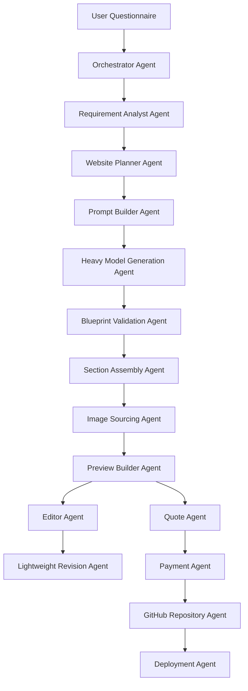

# AI Website Generator — Agents Specification

**Project:** AI Website Generator  
**File purpose:** Define all logical AI and automation agents used by the platform.  
**Important architecture rule:** There is no local AI generation. Initial website generation uses a heavy model API. Later revisions use a lightweight model API.

---

## 1. Agent System Overview

The platform uses a group of specialized agents. These agents do not need to be separate servers at MVP stage. They can be implemented as backend services, functions, or workflow steps. The purpose of naming them as agents is to keep responsibilities clean and easy to understand.



---

## 2. Main Agent List

| Agent | Main Responsibility | Model Type |
|---|---|---|
| Orchestrator Agent | Controls end-to-end workflow | No model required |
| Requirement Analyst Agent | Cleans and structures user inputs | Heavy model or rules |
| Website Planner Agent | Plans pages, sections, layout, SEO | Heavy model |
| Prompt Builder Agent | Builds model prompts safely | No model required |
| Heavy Model Generation Agent | Creates full initial website blueprint | Heavy model API |
| Blueprint Validation Agent | Validates AI output schema | No model required |
| Section Assembly Agent | Maps blueprint to ShadCN sections | No model required |
| Image Sourcing Agent | Gets images from Shutterstock/Pexels/Unsplash | No model required |
| Theme Agent | Creates design tokens and theme mapping | Heavy model or rules |
| Preview Builder Agent | Builds live preview | No model required |
| Editor Agent | Handles manual edits | No model required |
| Lightweight Revision Agent | Handles later AI edits | Lightweight model API |
| Quote Agent | Calculates automated quote | No model required |
| Payment Agent | Handles Stripe payment state | No model required |
| GitHub Repository Agent | Saves project files in GitHub | No model required |
| Deployment Agent | Deploys project to subdomain | No model required |
| Export Agent | Creates ZIP package for self-hosting | No model required |
| QA Agent | Checks generated site quality | Lightweight model or rules |
| Security Guardrail Agent | Prevents unsafe outputs and secret leakage | Rules + validation |

---

## 3. Agent Design Principles

1. **Do not let AI generate unrestricted frontend code.**  
   AI should generate a structured blueprint. The app should map that blueprint to approved ShadCN UI sections.

2. **Use heavy model only where quality matters most.**  
   Heavy model is used for first full website generation, planning, SEO, and section strategy.

3. **Use lightweight model for small edits.**  
   Lightweight model is used for section rewrite, tone changes, FAQ generation, and small text updates.

4. **Keep pricing deterministic.**  
   Quote Agent should use fixed rules and formulas, not AI opinion.

5. **Keep payment and deployment event-driven.**  
   Stripe webhook success should trigger GitHub save, export, or deployment.

6. **Keep image selection provider-based.**  
   Images come from Shutterstock first, then Pexels, then Unsplash.

7. **HubSpot syncs the platform account, never the generated site's visitors.**  
   Upsert the account owner as a HubSpot contact using standard properties only (name, email, company, phone, website, lifecyclestage, hs_analytics_source as Direct Traffic). Login drops the contact as a lead immediately and creates a HubSpot Lead record (Leads object) associated to the contact as primary contact. The lead name is the person or business name only. The numeric score is written to the Lead Score property (`lead_score` by default), `hs_lead_label` follows COLD/WARM/HOT, and the lead starts in the New stage. Each scoring step appends a Note on that contact (action, points, running total) so HubSpot shows progress in order. A website-package payment moves the lead to the Closed Won lead stage. Completing the questionnaire opens a deal on pipeline `941017774` named `Company $Amount` (amount starts at paid totals, often $0), with a `description` that includes the website URL, the full questionnaire answers, every paid line item, and a HubSpot-style combined deal score (engagement + fit groups with limits, A1–C3 threshold). Deal stages advance with progress: Preview Generated (questionnaire) → Content Generation (website generated) → Credit Bought → Quotation Generated → Closed Won (website package paid). Credit-pack purchases update that same deal even before the website is bought. Paying for the website package moves the deal to Closed Won, sets `closedate`, adds the website charge to `amount`, and awards engagement score points. The deal is associated to the contact, company, and Closed Won lead, and the contact moves to customer. Scoring follows HubSpot's deal lead-scoring model (engagement actions vs fit profile, group limits, overall score limit). Do not invent other custom HubSpot properties. Lead score, marketing consent, and scoring history also stay in our database and are visible on the admin clients page. Do not sync form leads captured by generated websites.

   Contacts are synced from login/registration onward, not only after payment. Consent is recorded locally and is not sent to HubSpot: a contact without marketing consent is still created, and must never be marketed to from HubSpot lists.

   All HubSpot work goes through the outbox (`lib/crm/`). No user-facing request may block on a HubSpot call.

   Contacts are synced from registration onward, not only after payment, because scoring needs them. Consent governs marketing, not existence: a contact without `marketing_consent` is still created, and must never be marketed to.

   All HubSpot work goes through the outbox (`lib/crm/`). No user-facing request may block on a HubSpot call.

8. **No local AI.**  
   All AI tasks use API-based heavy or lightweight models.

9. **Design every website with the three design skills.**  
   Before any visual, copy, or motion decision, the designing agents read and follow `frontend-design`, `animation-vocabulary`, and `hyperframes-animation`. The contract is in [Website design skills](#website-design-skills). The heavy model still returns a structured blueprint. It does not emit HTML, CSS, or animation scripts.

---

## 4. Orchestrator Agent

### Purpose

The Orchestrator Agent controls the complete workflow from questionnaire submission to final deployment or ZIP export.

### Responsibilities

- Start project generation workflow
- Call Requirement Analyst Agent
- Call Website Planner Agent
- Call Blueprint Validation Agent
- Call Section Assembly Agent
- Call Image Sourcing Agent
- Save project state
- Trigger quote calculation
- Trigger payment flow
- Trigger GitHub and deployment workflow after successful payment

### Input

```json
{
  "projectId": "project_123",
  "userId": "user_123",
  "questionnaireAnswers": {}
}
```

### Output

```json
{
  "projectId": "project_123",
  "status": "GENERATED",
  "nextStep": "PREVIEW"
}
```

### Guardrails

- Do not skip validation.
- Do not deploy before payment success.
- Do not create ZIP before package is paid.
- Do not call image providers without image keywords.

---

## 5. Requirement Analyst Agent

### Purpose

Convert raw questionnaire answers into clean structured requirements.

### Responsibilities

- Normalize business name
- Identify industry
- Extract services/products
- Extract target audience
- Identify preferred tone
- Identify page requirements
- Identify feature requirements
- Identify quote signals

### Input

```json
{
  "businessName": "Bright Smile Dental",
  "industry": "Dental Clinic",
  "description": "family dentist offering cleaning and whitening",
  "targetAudience": "families and professionals",
  "style": "modern and clean"
}
```

### Output

```json
{
  "business": {
    "name": "Bright Smile Dental",
    "industry": "Dental Clinic",
    "category": "Healthcare Services"
  },
  "services": ["Dental Cleaning", "Teeth Whitening"],
  "targetAudience": ["Families", "Working professionals"],
  "tone": "Modern, clean, trustworthy",
  "quoteSignals": ["service_business", "contact_form", "multi_section_homepage"]
}
```

### Model Strategy

- Can use heavy model during first generation.
- Can also be implemented using rules for MVP.

---

## 6. Website Planner Agent

### Purpose

Create the website strategy before content and UI assembly.

### Responsibilities

- Decide pages
- Decide section order
- Recommend ShadCN section types
- Create SEO metadata
- Create CTA strategy
- Recommend image keywords
- Determine complexity level
- Write the design plan required by [Website design skills](#website-design-skills) before any section list is accepted

### Design skills

Read `frontend-design` first. Ground pages, hero, and section order in this business, then review the plan against the generic defaults in that skill and revise before planning is finished. Name any motion with `animation-vocabulary`. Choose at most one orchestrated motion moment using `hyperframes-animation` (2–4 atomic rules).

### Input

```json
{
  "business": {},
  "services": [],
  "targetAudience": [],
  "tone": "Modern and trustworthy"
}
```

### Output

```json
{
  "pages": [
    {
      "slug": "home",
      "sections": ["hero", "services", "about", "testimonials", "faq", "contact"]
    }
  ],
  "seo": {
    "title": "Bright Smile Dental | Family Dental Care",
    "description": "Modern dental care for families and professionals."
  },
  "complexity": "medium"
}
```

### Model Strategy

Use heavy model API.

---

## 7. Prompt Builder Agent

### Purpose

Build clean prompts for the heavy model and lightweight model.

### Responsibilities

- Prepare system instruction
- Add questionnaire context
- Add section registry rules
- Add output JSON schema
- Prevent unsupported UI variants
- Keep model output structured
- Paste the operative rules from [Website design skills](#website-design-skills) into the generation prompt

### Guardrail Prompt Rules

The prompt must tell the model:

```text
Return only valid JSON.
Use only approved section types.
Do not invent unsupported components.
Do not generate unrestricted frontend code.
Do not include API keys or secrets.
Do not include copyrighted text copied from external sources.
Follow frontend-design for palette, type, layout, and copy.
Name every motion with an animation-vocabulary term.
Choose motion with hyperframes-animation: one orchestrated moment, 2–4 atomic rules, transform and opacity only.
Do not return HTML, CSS, GSAP, or a HyperFrames composition.
```

---

## 8. Heavy Model Generation Agent

### Purpose

Use the heavy AI model API to generate the first full website blueprint.

### Responsibilities

- Generate full website blueprint
- Generate page structure
- Generate section content
- Generate SEO title and description
- Generate image keywords
- Generate design direction by following [Website design skills](#website-design-skills)
- Generate quote signals

### Design skills

Run the two-pass `frontend-design` plan (tokens, type, layout, principles, then a revision against generic defaults) before writing section copy. Write copy with that skill's writing rules. Record motion as glossary terms from `animation-vocabulary`, chosen with `hyperframes-animation`. Return the plan inside the blueprint's design direction. Do not return code.

### Input

```json
{
  "normalizedRequirements": {},
  "allowedSectionRegistry": {},
  "outputSchema": "WebsiteBlueprint"
}
```

### Output

```json
{
  "blueprint": {
    "business": {},
    "design": {},
    "pages": [],
    "seo": {},
    "quoteSignals": []
  }
}
```

### Model Strategy

Use heavy model API only for initial generation.

### Failure Handling

If model output is invalid:

1. Ask model to repair JSON.
2. Re-validate schema.
3. If still invalid, fallback to default template blueprint.

---

## 9. Blueprint Validation Agent

### Purpose

Validate the Website Blueprint before rendering or saving.

### Responsibilities

- Validate JSON structure
- Validate required fields
- Validate allowed section types
- Validate allowed section variants
- Validate content length
- Validate image keywords
- Validate SEO fields

### Recommended Tools

```text
Zod schemas
TypeScript types
Server-side validation
```

### Output

```json
{
  "valid": true,
  "errors": []
}
```

---

## 10. Section Assembly Agent

### Purpose

Convert the validated blueprint into actual ShadCN UI page sections.

### Responsibilities

- Select correct ShadCN section component
- Inject content into section props
- Apply theme tokens from the design plan
- Insert selected image references
- Produce renderable page structure
- Map the named motion plan onto the shared motion runtime (`templates/shared/motion/runtime.ts`)

### Design skills

Assembly does not invent a new look or a new animation. It applies the theme from `frontend-design` and only the motions already named with `animation-vocabulary` and chosen under `hyperframes-animation`. If a requested motion is not in the shared runtime, drop it. Do not inject GSAP, a second library, or a HyperFrames clip.

### Input

```json
{
  "blueprint": {},
  "sectionRegistry": {},
  "theme": {}
}
```

### Output

```json
{
  "pages": [
    {
      "slug": "home",
      "components": [
        {
          "componentName": "HeroSplitWithImage",
          "props": {}
        }
      ]
    }
  ]
}
```

### Important Rule

The Section Assembly Agent must never create random UI code directly from AI text. It should use only approved components.

---

## 11. Image Sourcing Agent

### Purpose

Find suitable stock images for website sections.

### Provider Priority

```text
1. Shutterstock
2. Pexels
3. Unsplash
4. Placeholder fallback
```

### Responsibilities

- Receive image keywords
- Search Shutterstock if API is configured
- Fallback to Pexels if Shutterstock is unavailable or has no result
- Fallback to Unsplash if Pexels is unavailable or has no result
- Return image reference object
- Add alt text
- Store provider and license metadata

### Input

```json
{
  "sectionId": "hero_1",
  "keywords": ["modern dental clinic", "dentist office"],
  "orientation": "landscape"
}
```

### Output

```json
{
  "provider": "pexels",
  "providerImageId": "12345",
  "url": "https://example.com/image.jpg",
  "altText": "Modern dental clinic interior",
  "attributionRequired": false
}
```

### Guardrails

- Do not use unlicensed images.
- Store provider metadata.
- Respect provider API limits.
- Do not download images if provider terms do not allow it.

---

## 12. Theme Agent

### Purpose

Create a visual theme for this specific business, using the design plan from [Website design skills](#website-design-skills).

### Responsibilities

- Read `frontend-design` and write the token plan before picking colors or type
- Suggest a color palette grounded in the business, then snap it to a catalog palette name
- Map the customer's color preference to Tailwind tokens when they named one (their choice wins)
- Pick typography from the catalog font ids, one family or two clearly distinct families
- Set border radius, spacing, and button style so they serve that plan
- Reject a theme that matches the generic defaults listed in `frontend-design` unless the questionnaire asked for that look

### Output

```json
{
  "colors": {
    "primary": "#2563EB",
    "secondary": "#F8FAFC",
    "accent": "#14B8A6"
  },
  "radius": "1rem",
  "fontStyle": "modern sans-serif"
}
```

The JSON above is the token shape. A real theme is the catalog palette and font chosen after the design plan, for this business. It is not a default blue, teal, and `1rem` radius.

---

## Website design skills

When the AI designs a website, these three skills are required. Read each file in full before planning, prompting, generating, theming, or assembling. Do not design from memory of them.

| Skill | File |
|---|---|
| `frontend-design` | `.claude/skills/frontend-design/SKILL.md` |
| `animation-vocabulary` | `.claude/skills/animation-vocabulary/SKILL.md` |
| `hyperframes-animation` | `.claude/skills/hyperframes-animation/SKILL.md` |

Agents that must follow them: Website Planner, Prompt Builder, Heavy Model Generation, Theme, Section Assembly, Lightweight Revision (copy only), and QA.

The blueprint stays structured. These skills decide the look, the words, and the motion. They do not authorize HTML, CSS, GSAP timelines, or a HyperFrames clip in the model output. Section Assembly maps the result onto approved components and `templates/shared/motion/runtime.ts`.

### frontend-design

Use this for palette, type, layout, and copy.

1. Ground the design in this business before choosing a look: industry, materials, audience, and the one job of the page. Take those from the questionnaire. If the subject is still unclear, name one concrete subject and confirm it. Do not start from a template aesthetic.
2. Work in two passes. First write a compact plan:
   - **Color.** 4–6 named hex values for this business.
   - **Type.** One family, or two that are clearly distinct, with a role for each. Set a real type scale. Keep line length under 80 characters. Give serif body text slightly more line-height.
   - **Layout.** One-sentence concept, an ASCII wireframe, and an alignment choice (left, center, or justified) made for this page.
   - **Principles.** What makes this page specific to this business.
3. Review that plan against the brief. If any part is the generic default you would ship for any similar business, revise it and say what changed. Only the revised plan may become the blueprint.
4. Open the hero with the most characteristic thing in this business's world. Use a big number, a small label, and a gradient accent only when that is actually the right hero for this subject.
5. Spend boldness in one place. Keep everything around it quiet. Structural devices (rules, numbers, labels) encode real information. Numbered markers are only for a real sequence.
6. One orchestrated motion moment on the page. Fade-and-slide on every section, and a hover transition on every card, is not that moment.
7. Write for the visitor. Plain verbs, sentence case, active voice, one job per line. A button says what happens when it is used, and that same verb is used for the result. An empty or failed state tells the visitor what to do next.
8. Ship the quality floor: responsive down to mobile, visible keyboard focus, `prefers-reduced-motion` respected, and contrast that stays readable.

Do not use these treatments unless the questionnaire explicitly asks for that look:

- Warm cream background, high-contrast serif, terracotta or clay accent (near `#D97757`).
- Near-black background with one acid-green or vermilion accent.
- Broadsheet layout: hairline rules, zero radius, newspaper columns.
- Identical rounded cards, one radius on everything, the same soft grey shadow, gradient washes as decoration.
- Tracked-out all-caps eyebrows, middle-dot meta lines, em-dash labels, monospace micro-labels, or an arrow stuck on every button.
- A single italic, bold, or recolored word in a headline. All-caps labels. A label stacked above content that does not add information.

Platform constraint: after the plan, snap color to one catalog palette name and type to catalog font ids. The model never returns a raw hex or a font stack. A color the customer named wins over the model's pick.

### animation-vocabulary

Use this to name motion. Every motion in the design plan uses a term from that skill's glossary, quoted as written there. Do not invent a term. If nothing in the glossary matches, use the closest term and say it is an approximation, or drop the motion.

Do not answer with the skill's "I'm ready" greeting. That greeting is for a naming question in chat. A website design uses the glossary directly.

Terms that fit a generated site: Fade in, Slide in, Scale in, Pop in, Reveal, Stagger, Orchestration, Scroll reveal, Parallax, Hover effect, Press / Tap feedback, Accordion / Collapse, Ease-out, Spring, Number ticker, Reduced motion.

### hyperframes-animation

Use this to choose and limit motion. Read `rules-index.md` in that skill and pick 2–4 atomic rules for the one orchestrated moment. Do not load a blueprint unless the page truly matches that multi-phase template, and do not load one speculatively.

For a customer website, apply the craft and leave the HyperFrames clip contract on the shelf:

- GSAP-style judgment is the default: a few rules, one coordinated motion.
- Spatial motion is transform and opacity only (`x`, `y`, `scale`, `rotation`). Do not animate `width`, `height`, `top`, or `left`.
- The moment answers something on the page (orient, reveal, confirm). It is not decoration on every block.
- Honor `prefers-reduced-motion` by removing or toning that moment down.
- No `Math.random`, `Date.now`, or `performance.now` in motion. No unbounded `repeat: -1` authored as a custom timeline.
- Map the chosen rules onto motions the shared runtime already runs: scroll reveal, stagger, number ticker, parallax, FAQ accordion, hover, and press. A rule the runtime cannot play is omitted, not reimplemented as new script.

Do not ship a HyperFrames composition, a paused master timeline, or a second animation library inside a generated site. Those belong to a HyperFrames clip, which this generator does not produce.

### Order during generation

```text
Requirement Analyst
      ↓
Website Planner — frontend-design plan, then revise
      ↓
Prompt Builder — plan + glossary terms + motion limits in the prompt
      ↓
Heavy Model — copy and design direction under those rules
      ↓
Theme Agent — snap the revised plan to catalog palette and font
      ↓
Section Assembly — approved sections + shared motion runtime only
      ↓
QA — reject generic defaults, unnamed motion, and extra motion moments
```

---

## 13. Preview Builder Agent

### Purpose

Render the generated website preview for the user.

### Responsibilities

- Load assembled page structure
- Render ShadCN components
- Apply theme
- Render selected images
- Support desktop/tablet/mobile preview
- Save preview state

### Output

```json
{
  "previewUrl": "/app/project/project_123/preview",
  "status": "READY"
}
```

---

## 14. Editor Agent

### Purpose

Handle user manual edits without AI.

### Responsibilities

- Edit text fields
- Change image selection
- Add section
- Remove section
- Reorder sections
- Change theme
- Save draft changes

### Important Rule

Manual edits should not call AI. AI should only be called when the user explicitly requests rewrite, regenerate, or improve text.

---

## 15. Lightweight Revision Agent

### Purpose

Handle later small AI-based edits with a lightweight model API.

### Used For

- Rewrite hero headline
- Make section shorter
- Make copy more professional
- Generate FAQ items
- Rewrite service description
- Change tone
- Create alternate CTA

### Input

```json
{
  "sectionId": "services_1",
  "currentContent": {},
  "instruction": "Make this section more professional and shorter",
  "brandTone": "modern and trustworthy"
}
```

### Output

```json
{
  "updatedContent": {},
  "changedFields": ["headline", "body"]
}
```

### Model Strategy

Use lightweight AI model API.

### Guardrails

- Only modify the selected section.
- Preserve business facts.
- Do not invent fake claims.
- Do not alter pricing unless user specifically edits pricing content.
- Copy edits follow the writing rules in `frontend-design` (see [Website design skills](#website-design-skills)).
- Do not restyle the site or add motion during a text edit.

---

## 16. Quote Agent

### Purpose

Calculate the full website quote automatically.

### Responsibilities

- Count pages
- Count sections
- Read complexity score
- Detect features
- Detect image licensing requirements
- Detect package type
- Calculate one-time cost
- Calculate monthly hosting cost if applicable
- Return line-item quote

### Input

```json
{
  "projectId": "project_123",
  "blueprint": {},
  "packageType": "MANAGED_HOSTING",
  "features": ["contact_form", "multi_page", "gallery"]
}
```

### Output

```json
{
  "oneTimeTotal": 999,1`
  "monthlyTotal": 49,
  "currency": "USD",
  "lineItems": [
    { "name": "Website creation fee", "amount": 799 },
    { "name": "Additional pages", "amount": 150 },
    { "name": "Managed hosting monthly", "amount": 49 }
  ]
}
```

### Important Rule

The Quote Agent must be deterministic. It must not ask a human to estimate manually.

---

## 17. Payment Agent

### Purpose

Handle Stripe checkout and payment/subscription states.

### Responsibilities

- Create Stripe checkout session
- Select correct price IDs
- Handle self-hosting one-time payment
- Handle managed hosting creation fee + monthly subscription
- Process Stripe webhooks
- Verify webhook signature
- Update payment status in SQLite
- Trigger next workflow step
- Upsert the paying platform customer in HubSpot (best-effort)
- Email the account owner when the ZIP is first ready or the site goes live

### Package Handling

#### Self Hosting

```text
Stripe one-time payment success
      ↓
Generate ZIP package
      ↓
Mark project as EXPORTED
```

#### Managed Hosting

```text
Stripe creation fee + subscription success
      ↓
Commit site to AI-WEBSITE-BUILDER-WEBSITE
      ↓
Deploy to subdomain
      ↓
Mark project as LIVE
```

---

## 18. GitHub Repository Agent

### Purpose

Save paid website files to the shared GitHub repo **AI-WEBSITE-BUILDER-WEBSITE**.

### Responsibilities

- Resolve `GITHUB_SITES_REPO` or `${GITHUB_ORG}/AI-WEBSITE-BUILDER-WEBSITE`
- Generate the static export
- Commit into `clients/<slug>/` (do not create a repo per project)
- Save the folder URL and commit SHA to the database
- Run after website-package payment, and on later saves while the project is paid

### Files to Commit

```text
clients/<slug>/index.html
clients/<slug>/*.html
clients/<slug>/public/
clients/<slug>/site.json
clients/<slug>/blueprint.json
clients/<slug>/package.json
```

### Output

```json
{
  "githubRepoUrl": "https://github.com/org/AI-WEBSITE-BUILDER-WEBSITE/tree/main/clients/acme-ab12cd",
  "commitSha": "abc123"
}
```

---

## 19. Deployment Agent

### Purpose

Automatically deploy managed hosting websites to a subdomain.

### Responsibilities

- Trigger deployment provider
- Configure build settings
- Assign generated subdomain
- Track deployment status
- Save live URL
- Return final website URL to user

### Input

```json
{
  "projectId": "project_123",
  "githubRepoUrl": "https://github.com/org/project-repo",
  "subdomain": "bright-smile.aiwebsitebuilder.com"
}
```

### Output

```json
{
  "status": "DEPLOYED",
  "liveUrl": "https://bright-smile.aiwebsitebuilder.com"
}
```

### Deployment States

```text
PENDING
REPOSITORY_CREATED
BUILD_STARTED
DEPLOYED
FAILED
CANCELLED
```

---

## 20. Export Agent

### Purpose

Create ZIP source code package for self-hosting users.

### Responsibilities

- Generate full Next.js project folder
- Include ShadCN components
- Include assets and image references
- Include README instructions
- Include .env.example
- Compress into ZIP file
- Store download link

### Output

```json
{
  "zipFileName": "bright-smile-website.zip",
  "downloadReady": true
}
```

---

## 21. QA Agent

### Purpose

Check generated website quality before quote/payment/deployment.

### Responsibilities

- Check missing sections
- Check empty content fields
- Check broken image references
- Check missing CTA
- Check missing contact section
- Check SEO title and description
- Check basic accessibility labels
- Check mobile preview state
- Check the design plan against [Website design skills](#website-design-skills): generic defaults, unnamed motion, more than one orchestrated motion moment, and copy that does not say what the visitor should do

### Output

```json
{
  "passed": true,
  "warnings": [],
  "errors": []
}
```

### Model Strategy

- Rules first.
- Lightweight model optional for copy quality review.

---

## 22. Security Guardrail Agent

### Purpose

Protect the system from unsafe generation, data leakage, broken code, and secret exposure.

### Responsibilities

- Prevent API keys from appearing in generated files
- Sanitize AI text before rendering
- Validate generated URLs
- Validate image provider metadata
- Restrict generated code to approved templates
- Block unsafe script injection
- Verify Stripe webhook signatures
- Prevent deployment before payment success

### Important Rules

```text
Never expose server secrets in frontend code.
Never trust AI output without validation.
Never deploy unpaid projects.
Never allow AI to generate arbitrary executable backend code.
Never store card details in SQLite.
```

---

## 23. Agent Handoff Flow

### Initial Generation Flow

Design steps in this flow follow [Website design skills](#website-design-skills): `frontend-design` for the look and the words, `animation-vocabulary` for motion names, and `hyperframes-animation` for which motion to keep.

```text
Orchestrator Agent
      ↓
Requirement Analyst Agent
      ↓
Website Planner Agent
      ↓
Prompt Builder Agent
      ↓
Heavy Model Generation Agent
      ↓
Blueprint Validation Agent
      ↓
Theme Agent
      ↓
Section Assembly Agent
      ↓
Image Sourcing Agent
      ↓
Preview Builder Agent
```

### Editing Flow

```text
Editor Agent
      ↓ if AI edit requested
Lightweight Revision Agent
      ↓
Blueprint Validation Agent
      ↓
Section Assembly Agent
      ↓
Preview Builder Agent
```

### Payment and Delivery Flow

```text
Quote Agent
      ↓
Payment Agent
      ↓
Stripe Webhook Success
      ↓
HubSpot customer sync
      ↓
GitHub Repository Agent (clients/<slug>/ in AI-WEBSITE-BUILDER-WEBSITE)
      ↓
Package Decision
      ↓
Self Hosting: Export Agent → notify owner
      ↓
Managed Hosting: Deployment Agent → notify owner
```

---

## 24. Suggested Implementation Order

### Phase 1 — Core MVP

1. Questionnaire
2. Heavy model blueprint generation
3. Blueprint validation
4. ShadCN section rendering
5. Image fallback search
6. Live preview
7. Manual editor
8. Lightweight AI section rewrite

### Phase 2 — Business Automation

1. Automated quote engine
2. Stripe checkout
3. Stripe webhook handling
4. Self-hosting ZIP export

### Phase 3 — Deployment Automation

1. GitHub repository creation
2. Code commit automation
3. Managed hosting deployment
4. Subdomain assignment
5. Deployment status page

---

## 25. Final Agent Summary

The AI Website Generator should be built around structured agents, not one large AI prompt. The heavy model creates the first complete website blueprint. Visual design, copy, and motion follow `frontend-design`, `animation-vocabulary`, and `hyperframes-animation` as specified in [Website design skills](#website-design-skills). The platform then uses approved ShadCN UI sections and the shared motion runtime to assemble the site. Stock images are selected through provider APIs. Later edits are handled by a cheaper lightweight model. The quote, payment, GitHub storage, ZIP export, and subdomain deployment are all automated through deterministic backend agents.

<!-- stripe-projects-cli managed:agents-md:start -->
## Stripe Projects CLI

This repository is initialized for the Stripe project "website builder".

## Tools used

- [Stripe CLI](https://docs.stripe.com/stripe-cli) with the `projects` plugin to manage third-party services, credentials, and deployments for this project. Use the stripe-projects-cli to manage deploying and access to third party services.
<!-- stripe-projects-cli managed:agents-md:end -->
