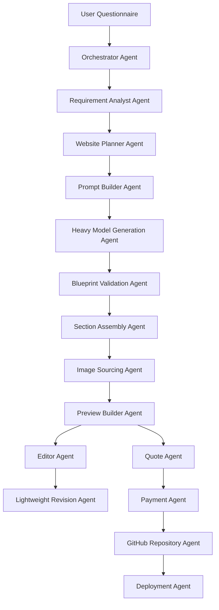

# AI Website Generator — Agents Specification

**Project:** AI Website Generator  
**File purpose:** Define all logical AI and automation agents used by the platform.  
**Important architecture rule:** There is no local AI generation. Initial website generation uses a heavy model API. Later revisions use a lightweight model API.

---

## 1. Agent System Overview

The platform uses a group of specialized agents. These agents do not need to be separate servers at MVP stage. They can be implemented as backend services, functions, or workflow steps. The purpose of naming them as agents is to keep responsibilities clean and easy to understand.



---

## 2. Main Agent List

| Agent | Main Responsibility | Model Type |
|---|---|---|
| Orchestrator Agent | Controls end-to-end workflow | No model required |
| Requirement Analyst Agent | Cleans and structures user inputs | Heavy model or rules |
| Website Planner Agent | Plans pages, sections, layout, SEO | Heavy model |
| Prompt Builder Agent | Builds model prompts safely | No model required |
| Heavy Model Generation Agent | Creates full initial website blueprint | Heavy model API |
| Blueprint Validation Agent | Validates AI output schema | No model required |
| Section Assembly Agent | Maps blueprint to ShadCN sections | No model required |
| Image Sourcing Agent | Gets images from Shutterstock/Pexels/Unsplash | No model required |
| Theme Agent | Creates design tokens and theme mapping | Heavy model or rules |
| Preview Builder Agent | Builds live preview | No model required |
| Editor Agent | Handles manual edits | No model required |
| Lightweight Revision Agent | Handles later AI edits | Lightweight model API |
| Quote Agent | Calculates automated quote | No model required |
| Payment Agent | Handles Stripe payment state | No model required |
| GitHub Repository Agent | Saves project files in GitHub | No model required |
| Deployment Agent | Deploys project to subdomain | No model required |
| Export Agent | Creates ZIP package for self-hosting | No model required |
| QA Agent | Checks generated site quality | Lightweight model or rules |
| Security Guardrail Agent | Prevents unsafe outputs and secret leakage | Rules + validation |

---

## 3. Agent Design Principles

1. **Do not let AI generate unrestricted frontend code.**  
   AI should generate a structured blueprint. The app should map that blueprint to approved ShadCN UI sections.

2. **Use heavy model only where quality matters most.**  
   Heavy model is used for first full website generation, planning, SEO, and section strategy.

3. **Use lightweight model for small edits.**  
   Lightweight model is used for section rewrite, tone changes, FAQ generation, and small text updates.

4. **Keep pricing deterministic.**  
   Quote Agent should use fixed rules and formulas, not AI opinion.

5. **Keep payment and deployment event-driven.**  
   Stripe webhook success should trigger GitHub save, export, or deployment.

6. **Keep image selection provider-based.**  
   Images come from Shutterstock first, then Pexels, then Unsplash.

7. **No HubSpot sync.**  
   CRM sync is removed from this architecture.

8. **No local AI.**  
   All AI tasks use API-based heavy or lightweight models.

---

## 4. Orchestrator Agent

### Purpose

The Orchestrator Agent controls the complete workflow from questionnaire submission to final deployment or ZIP export.

### Responsibilities

- Start project generation workflow
- Call Requirement Analyst Agent
- Call Website Planner Agent
- Call Blueprint Validation Agent
- Call Section Assembly Agent
- Call Image Sourcing Agent
- Save project state
- Trigger quote calculation
- Trigger payment flow
- Trigger GitHub and deployment workflow after successful payment

### Input

```json
{
  "projectId": "project_123",
  "userId": "user_123",
  "questionnaireAnswers": {}
}
```

### Output

```json
{
  "projectId": "project_123",
  "status": "GENERATED",
  "nextStep": "PREVIEW"
}
```

### Guardrails

- Do not skip validation.
- Do not deploy before payment success.
- Do not create ZIP before package is paid.
- Do not call image providers without image keywords.

---

## 5. Requirement Analyst Agent

### Purpose

Convert raw questionnaire answers into clean structured requirements.

### Responsibilities

- Normalize business name
- Identify industry
- Extract services/products
- Extract target audience
- Identify preferred tone
- Identify page requirements
- Identify feature requirements
- Identify quote signals

### Input

```json
{
  "businessName": "Bright Smile Dental",
  "industry": "Dental Clinic",
  "description": "family dentist offering cleaning and whitening",
  "targetAudience": "families and professionals",
  "style": "modern and clean"
}
```

### Output

```json
{
  "business": {
    "name": "Bright Smile Dental",
    "industry": "Dental Clinic",
    "category": "Healthcare Services"
  },
  "services": ["Dental Cleaning", "Teeth Whitening"],
  "targetAudience": ["Families", "Working professionals"],
  "tone": "Modern, clean, trustworthy",
  "quoteSignals": ["service_business", "contact_form", "multi_section_homepage"]
}
```

### Model Strategy

- Can use heavy model during first generation.
- Can also be implemented using rules for MVP.

---

## 6. Website Planner Agent

### Purpose

Create the website strategy before content and UI assembly.

### Responsibilities

- Decide pages
- Decide section order
- Recommend ShadCN section types
- Create SEO metadata
- Create CTA strategy
- Recommend image keywords
- Determine complexity level

### Input

```json
{
  "business": {},
  "services": [],
  "targetAudience": [],
  "tone": "Modern and trustworthy"
}
```

### Output

```json
{
  "pages": [
    {
      "slug": "home",
      "sections": ["hero", "services", "about", "testimonials", "faq", "contact"]
    }
  ],
  "seo": {
    "title": "Bright Smile Dental | Family Dental Care",
    "description": "Modern dental care for families and professionals."
  },
  "complexity": "medium"
}
```

### Model Strategy

Use heavy model API.

---

## 7. Prompt Builder Agent

### Purpose

Build clean prompts for the heavy model and lightweight model.

### Responsibilities

- Prepare system instruction
- Add questionnaire context
- Add section registry rules
- Add output JSON schema
- Prevent unsupported UI variants
- Keep model output structured

### Guardrail Prompt Rules

The prompt must tell the model:

```text
Return only valid JSON.
Use only approved section types.
Do not invent unsupported components.
Do not generate unrestricted frontend code.
Do not include API keys or secrets.
Do not include copyrighted text copied from external sources.
```

---

## 8. Heavy Model Generation Agent

### Purpose

Use the heavy AI model API to generate the first full website blueprint.

### Responsibilities

- Generate full website blueprint
- Generate page structure
- Generate section content
- Generate SEO title and description
- Generate image keywords
- Generate design direction
- Generate quote signals

### Input

```json
{
  "normalizedRequirements": {},
  "allowedSectionRegistry": {},
  "outputSchema": "WebsiteBlueprint"
}
```

### Output

```json
{
  "blueprint": {
    "business": {},
    "design": {},
    "pages": [],
    "seo": {},
    "quoteSignals": []
  }
}
```

### Model Strategy

Use heavy model API only for initial generation.

### Failure Handling

If model output is invalid:

1. Ask model to repair JSON.
2. Re-validate schema.
3. If still invalid, fallback to default template blueprint.

---

## 9. Blueprint Validation Agent

### Purpose

Validate the Website Blueprint before rendering or saving.

### Responsibilities

- Validate JSON structure
- Validate required fields
- Validate allowed section types
- Validate allowed section variants
- Validate content length
- Validate image keywords
- Validate SEO fields

### Recommended Tools

```text
Zod schemas
TypeScript types
Server-side validation
```

### Output

```json
{
  "valid": true,
  "errors": []
}
```

---

## 10. Section Assembly Agent

### Purpose

Convert the validated blueprint into actual ShadCN UI page sections.

### Responsibilities

- Select correct ShadCN section component
- Inject content into section props
- Apply theme tokens
- Insert selected image references
- Produce renderable page structure

### Input

```json
{
  "blueprint": {},
  "sectionRegistry": {},
  "theme": {}
}
```

### Output

```json
{
  "pages": [
    {
      "slug": "home",
      "components": [
        {
          "componentName": "HeroSplitWithImage",
          "props": {}
        }
      ]
    }
  ]
}
```

### Important Rule

The Section Assembly Agent must never create random UI code directly from AI text. It should use only approved components.

---

## 11. Image Sourcing Agent

### Purpose

Find suitable stock images for website sections.

### Provider Priority

```text
1. Shutterstock
2. Pexels
3. Unsplash
4. Placeholder fallback
```

### Responsibilities

- Receive image keywords
- Search Shutterstock if API is configured
- Fallback to Pexels if Shutterstock is unavailable or has no result
- Fallback to Unsplash if Pexels is unavailable or has no result
- Return image reference object
- Add alt text
- Store provider and license metadata

### Input

```json
{
  "sectionId": "hero_1",
  "keywords": ["modern dental clinic", "dentist office"],
  "orientation": "landscape"
}
```

### Output

```json
{
  "provider": "pexels",
  "providerImageId": "12345",
  "url": "https://example.com/image.jpg",
  "altText": "Modern dental clinic interior",
  "attributionRequired": false
}
```

### Guardrails

- Do not use unlicensed images.
- Store provider metadata.
- Respect provider API limits.
- Do not download images if provider terms do not allow it.

---

## 12. Theme Agent

### Purpose

Create a clean visual theme based on user preferences and industry.

### Responsibilities

- Suggest color palette
- Map user color preference to Tailwind tokens
- Pick typography style
- Set border radius preference
- Set spacing style
- Define button style

### Output

```json
{
  "colors": {
    "primary": "#2563EB",
    "secondary": "#F8FAFC",
    "accent": "#14B8A6"
  },
  "radius": "1rem",
  "fontStyle": "modern sans-serif"
}
```

---

## 13. Preview Builder Agent

### Purpose

Render the generated website preview for the user.

### Responsibilities

- Load assembled page structure
- Render ShadCN components
- Apply theme
- Render selected images
- Support desktop/tablet/mobile preview
- Save preview state

### Output

```json
{
  "previewUrl": "/app/project/project_123/preview",
  "status": "READY"
}
```

---

## 14. Editor Agent

### Purpose

Handle user manual edits without AI.

### Responsibilities

- Edit text fields
- Change image selection
- Add section
- Remove section
- Reorder sections
- Change theme
- Save draft changes

### Important Rule

Manual edits should not call AI. AI should only be called when the user explicitly requests rewrite, regenerate, or improve text.

---

## 15. Lightweight Revision Agent

### Purpose

Handle later small AI-based edits with a lightweight model API.

### Used For

- Rewrite hero headline
- Make section shorter
- Make copy more professional
- Generate FAQ items
- Rewrite service description
- Change tone
- Create alternate CTA

### Input

```json
{
  "sectionId": "services_1",
  "currentContent": {},
  "instruction": "Make this section more professional and shorter",
  "brandTone": "modern and trustworthy"
}
```

### Output

```json
{
  "updatedContent": {},
  "changedFields": ["headline", "body"]
}
```

### Model Strategy

Use lightweight AI model API.

### Guardrails

- Only modify the selected section.
- Preserve business facts.
- Do not invent fake claims.
- Do not alter pricing unless user specifically edits pricing content.

---

## 16. Quote Agent

### Purpose

Calculate the full website quote automatically.

### Responsibilities

- Count pages
- Count sections
- Read complexity score
- Detect features
- Detect image licensing requirements
- Detect package type
- Calculate one-time cost
- Calculate monthly hosting cost if applicable
- Return line-item quote

### Input

```json
{
  "projectId": "project_123",
  "blueprint": {},
  "packageType": "MANAGED_HOSTING",
  "features": ["contact_form", "multi_page", "gallery"]
}
```

### Output

```json
{
  "oneTimeTotal": 999,
  "monthlyTotal": 49,
  "currency": "USD",
  "lineItems": [
    { "name": "Website creation fee", "amount": 799 },
    { "name": "Additional pages", "amount": 150 },
    { "name": "Managed hosting monthly", "amount": 49 }
  ]
}
```

### Important Rule

The Quote Agent must be deterministic. It must not ask a human to estimate manually.

---

## 17. Payment Agent

### Purpose

Handle Stripe checkout and payment/subscription states.

### Responsibilities

- Create Stripe checkout session
- Select correct price IDs
- Handle self-hosting one-time payment
- Handle managed hosting creation fee + monthly subscription
- Process Stripe webhooks
- Verify webhook signature
- Update payment status in SQLite
- Trigger next workflow step

### Package Handling

#### Self Hosting

```text
Stripe one-time payment success
      ↓
Generate ZIP package
      ↓
Mark project as EXPORTED
```

#### Managed Hosting

```text
Stripe creation fee + subscription success
      ↓
Save project to GitHub
      ↓
Deploy to subdomain
      ↓
Mark project as LIVE
```

---

## 18. GitHub Repository Agent

### Purpose

Save generated website files to GitHub.

### Responsibilities

- Create new repository or project folder
- Generate project source code
- Commit files
- Save repository URL to database
- Manage version history

### Files to Commit

```text
package.json
next.config.js
tailwind.config.ts
app/
components/
public/
README.md
.env.example
```

### Output

```json
{
  "githubRepoUrl": "https://github.com/org/project-repo",
  "commitSha": "abc123"
}
```

---

## 19. Deployment Agent

### Purpose

Automatically deploy managed hosting websites to a subdomain.

### Responsibilities

- Trigger deployment provider
- Configure build settings
- Assign generated subdomain
- Track deployment status
- Save live URL
- Return final website URL to user

### Input

```json
{
  "projectId": "project_123",
  "githubRepoUrl": "https://github.com/org/project-repo",
  "subdomain": "bright-smile.aiwebsitebuilder.com"
}
```

### Output

```json
{
  "status": "DEPLOYED",
  "liveUrl": "https://bright-smile.aiwebsitebuilder.com"
}
```

### Deployment States

```text
PENDING
REPOSITORY_CREATED
BUILD_STARTED
DEPLOYED
FAILED
CANCELLED
```

---

## 20. Export Agent

### Purpose

Create ZIP source code package for self-hosting users.

### Responsibilities

- Generate full Next.js project folder
- Include ShadCN components
- Include assets and image references
- Include README instructions
- Include .env.example
- Compress into ZIP file
- Store download link

### Output

```json
{
  "zipFileName": "bright-smile-website.zip",
  "downloadReady": true
}
```

---

## 21. QA Agent

### Purpose

Check generated website quality before quote/payment/deployment.

### Responsibilities

- Check missing sections
- Check empty content fields
- Check broken image references
- Check missing CTA
- Check missing contact section
- Check SEO title and description
- Check basic accessibility labels
- Check mobile preview state

### Output

```json
{
  "passed": true,
  "warnings": [],
  "errors": []
}
```

### Model Strategy

- Rules first.
- Lightweight model optional for copy quality review.

---

## 22. Security Guardrail Agent

### Purpose

Protect the system from unsafe generation, data leakage, broken code, and secret exposure.

### Responsibilities

- Prevent API keys from appearing in generated files
- Sanitize AI text before rendering
- Validate generated URLs
- Validate image provider metadata
- Restrict generated code to approved templates
- Block unsafe script injection
- Verify Stripe webhook signatures
- Prevent deployment before payment success

### Important Rules

```text
Never expose server secrets in frontend code.
Never trust AI output without validation.
Never deploy unpaid projects.
Never allow AI to generate arbitrary executable backend code.
Never store card details in SQLite.
```

---

## 23. Agent Handoff Flow

### Initial Generation Flow

```text
Orchestrator Agent
      ↓
Requirement Analyst Agent
      ↓
Website Planner Agent
      ↓
Prompt Builder Agent
      ↓
Heavy Model Generation Agent
      ↓
Blueprint Validation Agent
      ↓
Theme Agent
      ↓
Section Assembly Agent
      ↓
Image Sourcing Agent
      ↓
Preview Builder Agent
```

### Editing Flow

```text
Editor Agent
      ↓ if AI edit requested
Lightweight Revision Agent
      ↓
Blueprint Validation Agent
      ↓
Section Assembly Agent
      ↓
Preview Builder Agent
```

### Payment and Delivery Flow

```text
Quote Agent
      ↓
Payment Agent
      ↓
Stripe Webhook Success
      ↓
Package Decision
      ↓
Self Hosting: Export Agent
      ↓
Managed Hosting: GitHub Repository Agent → Deployment Agent
```

---

## 24. Suggested Implementation Order

### Phase 1 — Core MVP

1. Questionnaire
2. Heavy model blueprint generation
3. Blueprint validation
4. ShadCN section rendering
5. Image fallback search
6. Live preview
7. Manual editor
8. Lightweight AI section rewrite

### Phase 2 — Business Automation

1. Automated quote engine
2. Stripe checkout
3. Stripe webhook handling
4. Self-hosting ZIP export

### Phase 3 — Deployment Automation

1. GitHub repository creation
2. Code commit automation
3. Managed hosting deployment
4. Subdomain assignment
5. Deployment status page

---

## 25. Final Agent Summary

The AI Website Generator should be built around structured agents, not one large AI prompt. The heavy model creates the first complete website blueprint. The platform then uses approved ShadCN UI sections to assemble the site. Stock images are selected through provider APIs. Later edits are handled by a cheaper lightweight model. The quote, payment, GitHub storage, ZIP export, and subdomain deployment are all automated through deterministic backend agents.
