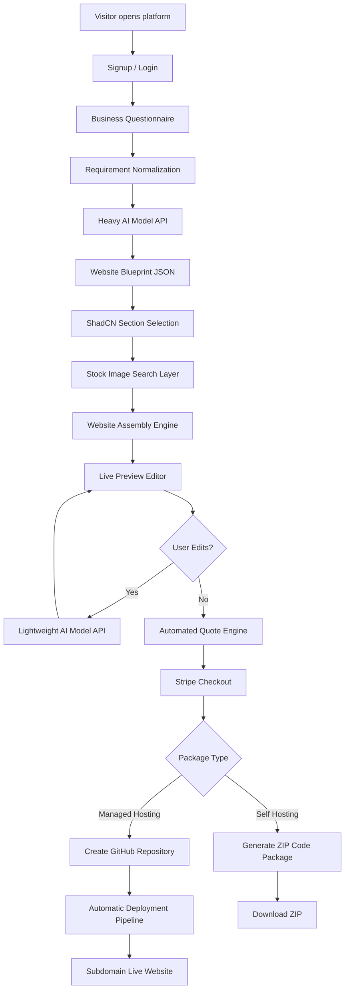
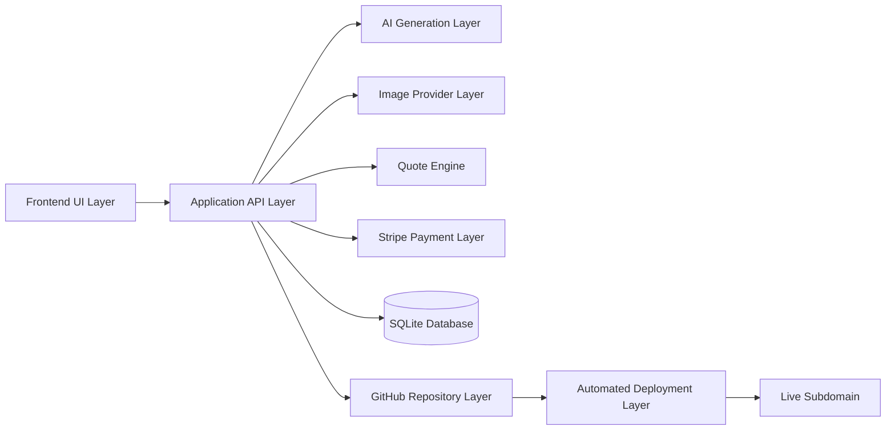
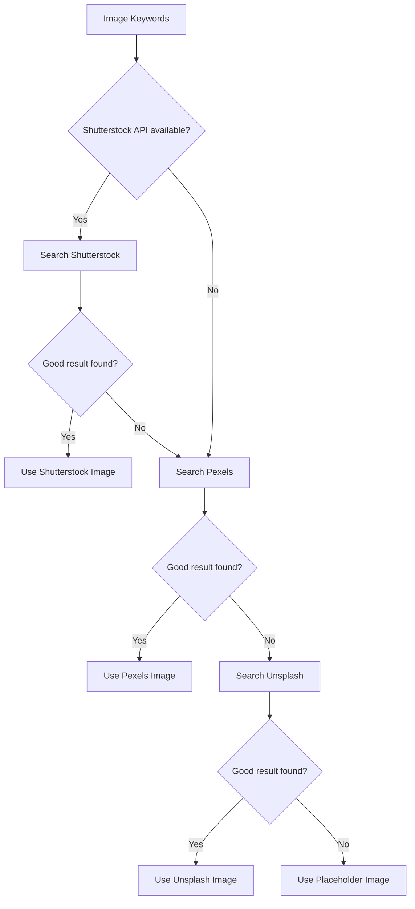
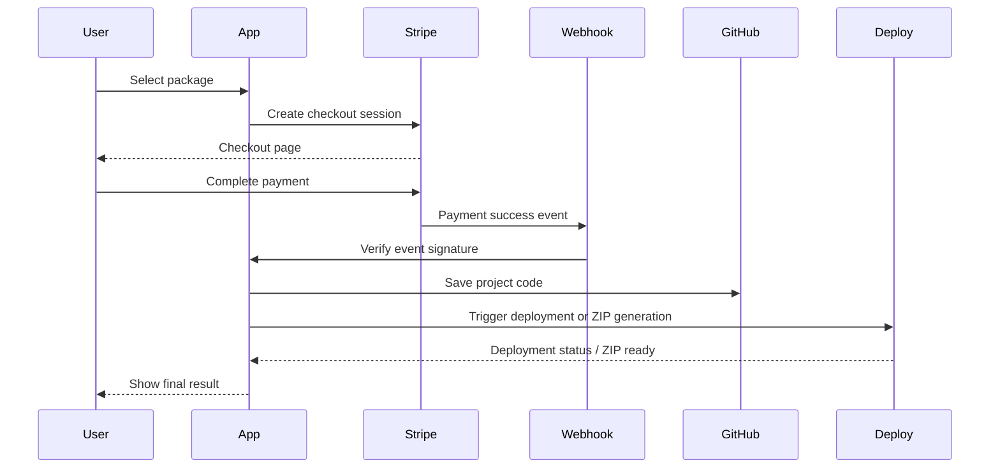

# AI Website Generator — Detailed System Architecture

**Project:** AI Website Generator  
**Architecture version:** v1.0  
**Purpose:** Build an automated platform that collects business requirements, generates a professional website using AI and prebuilt UI sections, calculates the quote automatically, accepts Stripe payment, saves the project to GitHub, and either provides a ZIP code package or deploys the website automatically on a subdomain.

---

## 1. Executive Summary

The AI Website Generator is a self-service website creation platform. A user signs up, fills a structured questionnaire, and receives a generated website preview. The first website generation uses a **heavy AI model API** because the system needs strong planning, section selection, content generation, and structured output quality. Later edits use a **lightweight AI model API** to reduce cost for small revisions such as rewriting a section, changing tone, adding FAQs, or modifying CTA text.

The system does **not use local AI generation**. All AI generation happens through external model APIs. The UI is not generated from scratch. Instead, the system uses a library of highly customizable **ShadCN UI + Tailwind CSS + Next.js sections**. Images are selected automatically from stock image providers in this fallback order:

1. Shutterstock API, if API access is available
2. Pexels API fallback
3. Unsplash API fallback

The quote engine is fully automated. There is no manual quote preparation. After payment through Stripe, the project is saved to a GitHub repository. Depending on the package, the user either receives a ZIP code file for self-hosting or gets managed hosting with automatic deployment on a generated subdomain.

---

## 2. Updated Architecture Decisions

| Area | Final Decision |
|---|---|
| Local AI | Removed completely |
| Initial generation | Heavy AI model API |
| Later edits | Lightweight AI model API |
| UI system | Next.js + Tailwind CSS + ShadCN UI |
| Sections | Prebuilt, reusable, highly customizable sections |
| Images | Shutterstock → Pexels → Unsplash fallback chain |
| Quote engine | Fully automated, no manual quote step |
| Deployment | Automatic deployment to subdomain |
| CRM sync | HubSpot contact upsert for the paying platform customer after payment |
| Payment gateway | Stripe |
| Payment models | Self-hosting ZIP package OR managed hosting subscription |
| Repository storage | GitHub repository per project or controlled repo structure |
| Database | SQLite |
| ORM | Prisma |

---

## 3. High-Level System Flow



---

## 4. Core User Journey

### Step 1 — User Visits Platform

The user lands on the platform homepage and sees:

- Platform value proposition
- Example generated websites
- Pricing hints
- Trust signals
- Start website button

### Step 2 — Registration / Login

The user creates an account or logs in before generating a full website. Authentication is required so the system can save projects, payments, revisions, and hosting subscriptions.

### Step 3 — Questionnaire

The user fills a structured questionnaire. The questionnaire should collect clean business details instead of asking the AI with an unstructured prompt.

Main questionnaire groups:

- Business information
- Industry and category
- Target audience
- Location served
- Services or products
- Brand tone
- Design style
- Color preference
- Pages needed
- Contact details
- Hosting package preference
- Optional features

### Step 4 — Initial AI Generation

The system sends normalized questionnaire data to a heavy model API. The heavy model outputs a structured Website Blueprint JSON.

The heavy model should not directly create random frontend code. It should generate structured planning output such as:

- Recommended pages
- Recommended sections
- Section order
- Section content
- CTA strategy
- SEO metadata
- Image search keywords
- Brand tone
- Design direction
- Complexity tags

### Step 5 — ShadCN UI Website Assembly

The Website Assembly Engine maps the AI blueprint to prebuilt ShadCN UI sections.

Example mapping:

```text
Blueprint section: hero
       ↓
Selected UI block: hero-split-with-image
       ↓
Injected content: headline, subtitle, CTA, image
```

### Step 6 — Stock Image Selection

The Image Search Layer extracts keywords from the blueprint and searches providers in this order:

```text
Shutterstock API
      ↓ if unavailable or no suitable result
Pexels API
      ↓ if unavailable or no suitable result
Unsplash API
```

Images are stored as provider references and downloaded/cached only when license and API terms allow.

### Step 7 — Live Preview and Editing

The user sees the generated website in a live preview editor.

User can:

- Edit text manually
- Change images
- Add section
- Delete section
- Reorder sections
- Change color theme
- Ask AI to rewrite a section
- Regenerate a selected section

Minor AI edits are handled by a lightweight model API.

### Step 8 — Automated Quote

The quote engine calculates cost automatically using the website blueprint, selected features, number of pages, complexity score, image usage, and hosting package.

No manual pricing step is required.

### Step 9 — Stripe Payment

The user selects one of two payment options:

#### Option A — Self Hosting

The user pays a one-time website creation fee and receives a ZIP file containing source code.

Includes:

- Next.js source code
- ShadCN UI components
- Tailwind configuration
- Assets and image references
- README deployment guide
- Environment example file

#### Option B — Managed Hosting

The user pays:

- One-time website creation fee
- Monthly hosting subscription

The system automatically deploys the website to a generated subdomain.

### Step 10 — GitHub Storage and Deployment

After successful payment, the system saves the generated project in GitHub.

For managed hosting:

```text
Stripe payment success
      ↓
Create GitHub repository / project folder
      ↓
Commit generated code
      ↓
Trigger deployment pipeline
      ↓
Deploy to subdomain
      ↓
Return live URL to user
```

---

## 5. System Architecture Layers



---

## 6. Frontend Architecture

### Recommended Stack

```text
Next.js
React
TypeScript
Tailwind CSS
ShadCN UI
React Hook Form
Zod validation
```

### Main Frontend Pages

```text
/
/app/dashboard
/app/new-project
/app/project/[projectId]/questionnaire
/app/project/[projectId]/preview
/app/project/[projectId]/editor
/app/project/[projectId]/quote
/app/project/[projectId]/checkout
/app/project/[projectId]/deployment
/app/project/[projectId]/download
```

### Main Frontend Features

- Responsive landing page
- User dashboard
- Multi-step questionnaire
- Generated website preview
- Section-based editor
- Manual content editing
- AI edit buttons
- Quote display
- Stripe checkout redirect
- Deployment status page
- ZIP download page

---

## 7. Backend Architecture

The backend can be implemented with **Next.js API routes/server actions** for a simpler full-stack setup.

### Main Backend Modules

```text
Auth Module
Questionnaire Module
AI Generation Module
Website Blueprint Module
Section Assembly Module
Image Search Module
Quote Engine Module
Stripe Payment Module
GitHub Repository Module
Deployment Module
Project Export Module
```

### Backend Responsibilities

| Module | Responsibility |
|---|---|
| Auth Module | User registration, login, session handling |
| Questionnaire Module | Save and validate user answers |
| AI Generation Module | Call heavy or lightweight model APIs |
| Website Blueprint Module | Store structured website plan |
| Section Assembly Module | Convert blueprint to ShadCN sections |
| Image Search Module | Fetch stock images using fallback providers |
| Quote Engine Module | Calculate automatic project cost |
| Stripe Payment Module | Checkout, webhook processing, subscriptions |
| GitHub Module | Create repository, commit code, manage versions |
| Deployment Module | Deploy managed sites to subdomain |
| Export Module | Generate ZIP file for self-hosting users |

---

## 8. AI Generation Architecture

### 8.1 Heavy Model API — Initial Generation

Used for:

- First complete website generation
- Website planning
- Section strategy
- SEO metadata
- Full brand voice creation
- Layout recommendation
- Image keyword generation
- Complexity analysis

Input:

```json
{
  "businessName": "Example Dental Clinic",
  "industry": "Healthcare",
  "targetAudience": "Families and working professionals",
  "location": "Dallas, Texas",
  "services": ["Dental Cleaning", "Root Canal", "Teeth Whitening"],
  "style": "Modern, clean, trustworthy",
  "brandColors": ["blue", "white"],
  "pagesRequested": ["Home", "Services", "About", "Contact"]
}
```

Output:

```json
{
  "siteType": "service-business",
  "pages": [
    {
      "slug": "home",
      "title": "Home",
      "sections": [
        {
          "type": "hero",
          "variant": "hero-split-with-image",
          "headline": "Confident Smiles Start Here",
          "subheadline": "Modern dental care for families and professionals.",
          "ctaPrimary": "Book Appointment",
          "imageKeywords": ["modern dental clinic", "dentist office"]
        }
      ]
    }
  ],
  "seo": {
    "title": "Example Dental Clinic | Modern Dental Care",
    "description": "Family dental care with modern treatment options."
  },
  "complexity": {
    "level": "medium",
    "reasons": ["multiple service sections", "contact form", "image selection"]
  }
}
```

### 8.2 Lightweight Model API — Later Edits

Used for:

- Rewrite selected section
- Shorten copy
- Make copy more professional
- Generate FAQ answers
- Change tone
- Rewrite CTA
- Create alternative headline

The lightweight model should receive only the selected section and user instruction, not the full project unless needed.

---

## 9. Website Blueprint Structure

The Website Blueprint is the central object of the platform. It sits between AI output and frontend UI rendering.

```ts
export type WebsiteBlueprint = {
  projectId: string;
  business: {
    name: string;
    industry: string;
    description: string;
    location?: string;
  };
  design: {
    tone: string;
    colorPalette: string[];
    typography: string;
    visualStyle: string;
  };
  pages: WebsitePage[];
  seo: SiteSeo;
  quoteSignals: QuoteSignal[];
};

export type WebsitePage = {
  slug: string;
  title: string;
  sections: WebsiteSection[];
};

export type WebsiteSection = {
  id: string;
  type: string;
  variant: string;
  content: Record<string, string | string[]>;
  imageKeywords?: string[];
  selectedImage?: StockImageReference;
};
```

---

## 10. ShadCN Section Library

The platform should maintain a controlled section library. The AI only picks sections from allowed variants.

### Recommended Section Categories

```text
Hero
About
Services
Features
Portfolio
Process
Testimonials
FAQ
Pricing
Contact
CTA
Footer
```

### Example Section Registry

```ts
export const sectionRegistry = {
  hero: [
    "hero-centered",
    "hero-split-with-image",
    "hero-background-image",
  ],
  services: [
    "services-grid",
    "services-cards",
    "services-icon-list",
  ],
  contact: [
    "contact-simple",
    "contact-map-layout",
    "contact-card-form",
  ],
};
```

### Why This Approach Is Better

- Faster generation
- Cleaner UI
- Consistent quality
- Easier maintenance
- Less broken code
- Easier editing
- Better reuse across industries

---

## 11. Image Provider Layer

### Fallback Logic



### Image Reference Object

```ts
export type StockImageReference = {
  provider: "shutterstock" | "pexels" | "unsplash" | "placeholder";
  providerImageId?: string;
  url: string;
  photographer?: string;
  attributionRequired?: boolean;
  licenseInfo?: string;
  altText: string;
};
```

---

## 12. Quote Engine Architecture

The quote engine must be fully automated.

### Quote Inputs

```text
Number of pages
Number of sections
Complexity level
Custom forms
Blog requirement
E-commerce requirement
Booking integration
Image provider usage
AI generation usage
Hosting package
Maintenance package
Deployment type
```

### Quote Formula Example

```text
Total Quote = Base Website Fee
            + Page Cost
            + Section Complexity Cost
            + Feature Cost
            + Image Licensing Cost
            + Deployment Cost
            + Hosting Plan Cost
```

### Quote Data Object

```ts
export type Quote = {
  projectId: string;
  packageType: "self_hosting" | "managed_hosting";
  baseWebsiteFee: number;
  pageCost: number;
  sectionCost: number;
  featureCost: number;
  imageCost: number;
  deploymentCost: number;
  oneTimeTotal: number;
  monthlyTotal: number;
  currency: "USD";
  lineItems: QuoteLineItem[];
};
```

### Payment Package Logic

#### Self Hosting

```text
One-time payment only
User receives ZIP code package
No monthly hosting subscription
No automatic managed hosting
```

#### Managed Hosting

```text
One-time website creation fee
+
Monthly hosting subscription
Automatic deployment on subdomain
```

---

## 13. Stripe Payment Architecture



### Required Stripe Events

```text
checkout.session.completed
invoice.payment_succeeded
invoice.payment_failed
customer.subscription.created
customer.subscription.updated
customer.subscription.deleted
```

---

## 14. GitHub Repository Architecture

Projects should be committed to GitHub after successful payment.

### Possible Strategies

#### Strategy A — One Repository Per Project

```text
website-project-client-name-123
```

Best for:

- Clean separation
- Easy handoff
- Simple self-hosting package

#### Strategy B — Monorepo With Project Folders

```text
/generated-sites/project-123
/generated-sites/project-124
```

Best for:

- Centralized management
- Easier internal maintenance
- Shared deployment automation

### Recommended Initial Strategy

Start with **one repository per project** because it is easier to understand, export, and hand off to clients.

---

## 15. Automated Deployment Architecture

Managed hosting projects are deployed automatically after payment.

### Deployment Flow

```text
Payment success
      ↓
Generate code
      ↓
Create GitHub repository
      ↓
Commit project files
      ↓
Trigger deployment provider
      ↓
Assign generated subdomain
      ↓
Return live URL
```

### Subdomain Pattern

```text
client-business-name.platform-domain.com
```

Example:

```text
example-dental.aiwebsitebuilder.com
```

### Deployment Statuses

```text
pending
repository_created
build_started
deployed
failed
cancelled
```

---

## 16. Database Architecture — SQLite + Prisma

SQLite is used as the main database for the MVP. Prisma is used as ORM.

### Suggested Prisma Schema

```prisma
model User {
  id        String    @id @default(cuid())
  name      String?
  email     String    @unique
  password  String?
  createdAt DateTime  @default(now())
  updatedAt DateTime  @updatedAt
  projects  Project[]
  payments  Payment[]
}

model Project {
  id              String        @id @default(cuid())
  userId          String
  user            User          @relation(fields: [userId], references: [id])
  businessName    String
  industry        String?
  status          ProjectStatus @default(DRAFT)
  blueprintJson   String?
  githubRepoUrl   String?
  liveUrl         String?
  packageType     PackageType?
  createdAt       DateTime      @default(now())
  updatedAt       DateTime      @updatedAt
  questionnaire   Questionnaire?
  quote           Quote?
  payments        Payment[]
  deployments     Deployment[]
}

model Questionnaire {
  id        String   @id @default(cuid())
  projectId String   @unique
  project   Project  @relation(fields: [projectId], references: [id])
  answers   String
  createdAt DateTime @default(now())
  updatedAt DateTime @updatedAt
}

model Quote {
  id             String   @id @default(cuid())
  projectId      String   @unique
  project        Project  @relation(fields: [projectId], references: [id])
  packageType    PackageType
  oneTimeTotal   Float
  monthlyTotal   Float   @default(0)
  currency       String  @default("USD")
  lineItemsJson  String
  createdAt      DateTime @default(now())
  updatedAt      DateTime @updatedAt
}

model Payment {
  id                String        @id @default(cuid())
  userId            String
  projectId         String
  user              User          @relation(fields: [userId], references: [id])
  project           Project       @relation(fields: [projectId], references: [id])
  stripeSessionId   String?
  stripeCustomerId  String?
  stripeSubscriptionId String?
  amount            Float
  currency          String        @default("USD")
  status            PaymentStatus @default(PENDING)
  createdAt         DateTime      @default(now())
  updatedAt         DateTime      @updatedAt
}

model Deployment {
  id          String           @id @default(cuid())
  projectId   String
  project     Project          @relation(fields: [projectId], references: [id])
  provider    String
  subdomain   String?
  liveUrl     String?
  status      DeploymentStatus @default(PENDING)
  logsJson    String?
  createdAt   DateTime         @default(now())
  updatedAt   DateTime         @updatedAt
}

enum ProjectStatus {
  DRAFT
  GENERATED
  EDITING
  QUOTED
  PAID
  EXPORTED
  DEPLOYING
  LIVE
  FAILED
}

enum PackageType {
  SELF_HOSTING
  MANAGED_HOSTING
}

enum PaymentStatus {
  PENDING
  PAID
  FAILED
  REFUNDED
  CANCELLED
}

enum DeploymentStatus {
  PENDING
  REPOSITORY_CREATED
  BUILD_STARTED
  DEPLOYED
  FAILED
  CANCELLED
}
```

---

## 17. API Route Architecture

### Auth Routes

```text
POST /api/auth/signup
POST /api/auth/login
POST /api/auth/logout
GET  /api/auth/me
```

### Project Routes

```text
POST /api/projects
GET  /api/projects
GET  /api/projects/:projectId
PATCH /api/projects/:projectId
DELETE /api/projects/:projectId
```

### Questionnaire Routes

```text
POST /api/projects/:projectId/questionnaire
GET  /api/projects/:projectId/questionnaire
PATCH /api/projects/:projectId/questionnaire
```

### AI Generation Routes

```text
POST /api/projects/:projectId/generate
POST /api/projects/:projectId/edit-section
POST /api/projects/:projectId/regenerate-section
```

### Image Routes

```text
POST /api/images/search
POST /api/projects/:projectId/sections/:sectionId/select-image
```

### Quote Routes

```text
POST /api/projects/:projectId/quote
GET  /api/projects/:projectId/quote
```

### Payment Routes

```text
POST /api/projects/:projectId/checkout
POST /api/stripe/webhook
```

### Export Routes

```text
POST /api/projects/:projectId/export-zip
GET  /api/projects/:projectId/download
```

### Deployment Routes

```text
POST /api/projects/:projectId/deploy
GET  /api/projects/:projectId/deployment-status
```

---

## 18. Recommended Project Folder Structure

```text
ai-website-generator/
├── app/
│   ├── page.tsx
│   ├── dashboard/
│   ├── project/
│   │   └── [projectId]/
│   │       ├── questionnaire/
│   │       ├── preview/
│   │       ├── editor/
│   │       ├── quote/
│   │       ├── checkout/
│   │       └── deployment/
│   └── api/
│       ├── auth/
│       ├── projects/
│       ├── ai/
│       ├── images/
│       ├── quote/
│       ├── stripe/
│       ├── github/
│       └── deployment/
├── components/
│   ├── ui/
│   ├── website-sections/
│   │   ├── hero/
│   │   ├── services/
│   │   ├── about/
│   │   ├── testimonials/
│   │   ├── faq/
│   │   ├── contact/
│   │   └── footer/
│   └── editor/
├── lib/
│   ├── ai/
│   ├── images/
│   ├── quote/
│   ├── stripe/
│   ├── github/
│   ├── deployment/
│   ├── prisma.ts
│   └── utils.ts
├── prisma/
│   └── schema.prisma
├── generated-projects/
├── public/
├── architecture.md
├── agents.md
├── package.json
├── tailwind.config.ts
└── .env.example
```

---

## 19. Environment Variables

```env
DATABASE_URL="file:./dev.db"

HEAVY_MODEL_API_KEY=""
HEAVY_MODEL_NAME=""
LIGHT_MODEL_API_KEY=""
LIGHT_MODEL_NAME=""

SHUTTERSTOCK_API_KEY=""
PEXELS_API_KEY=""
UNSPLASH_ACCESS_KEY=""

STRIPE_SECRET_KEY=""
STRIPE_WEBHOOK_SECRET=""
STRIPE_SELF_HOSTING_PRICE_ID=""
STRIPE_MANAGED_CREATION_PRICE_ID=""
STRIPE_MANAGED_MONTHLY_PRICE_ID=""

GITHUB_TOKEN=""
GITHUB_ORG=""
GITHUB_SITES_REPO=""
GITHUB_REPO_VISIBILITY="private"

DEPLOYMENT_PROVIDER="vercel"
DEPLOYMENT_TOKEN=""
PLATFORM_DOMAIN="aiwebsitebuilder.com"
```

---

## 20. Security Requirements

- Never expose AI API keys to frontend.
- Never expose Stripe secret key to frontend.
- Verify Stripe webhook signatures.
- Store GitHub token securely.
- Validate all questionnaire inputs with Zod.
- Sanitize AI-generated content before rendering.
- Restrict generated code output to approved templates.
- Keep generated repositories private by default.
- Store only required payment metadata locally.
- Do not store raw card information.
- Use environment variables for secrets.
- Apply rate limits to AI generation endpoints.
- Log errors without exposing secrets.

---

## 21. MVP Scope

### MVP Must Include

- User signup/login
- Questionnaire
- Heavy model initial generation
- Blueprint JSON generation
- ShadCN section assembly
- Stock image fallback search
- Live preview
- Manual text editing
- Lightweight AI section edits
- Automated quote
- Stripe checkout
- Self-hosting ZIP export
- GitHub repository save
- Managed hosting deployment to subdomain
- SQLite + Prisma database

### Later Enhancements

- Advanced drag-and-drop editor
- Custom domain connection
- Blog generation
- E-commerce templates
- Booking integration
- Analytics dashboard
- Multi-language sites
- Team collaboration
- White-label agency portal

---

## 22. Final Architecture Summary

```text
User fills questionnaire
        ↓
Heavy AI model generates structured website blueprint
        ↓
System maps blueprint to ShadCN UI sections
        ↓
Images are selected from Shutterstock, then Pexels, then Unsplash
        ↓
Website is assembled in Next.js
        ↓
User previews and edits site
        ↓
Lightweight AI model handles small changes
        ↓
Automated quote engine calculates price
        ↓
Stripe processes payment
        ↓
Project is saved in GitHub
        ↓
Self-hosting users receive ZIP
        ↓
Managed hosting users get automatic subdomain deployment
```
